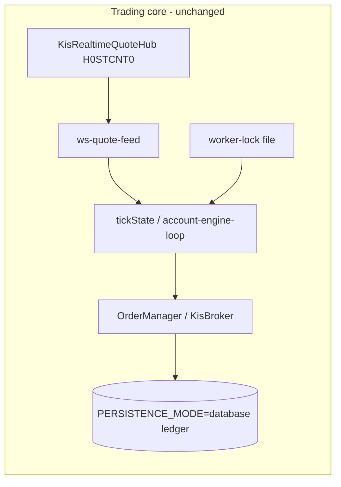
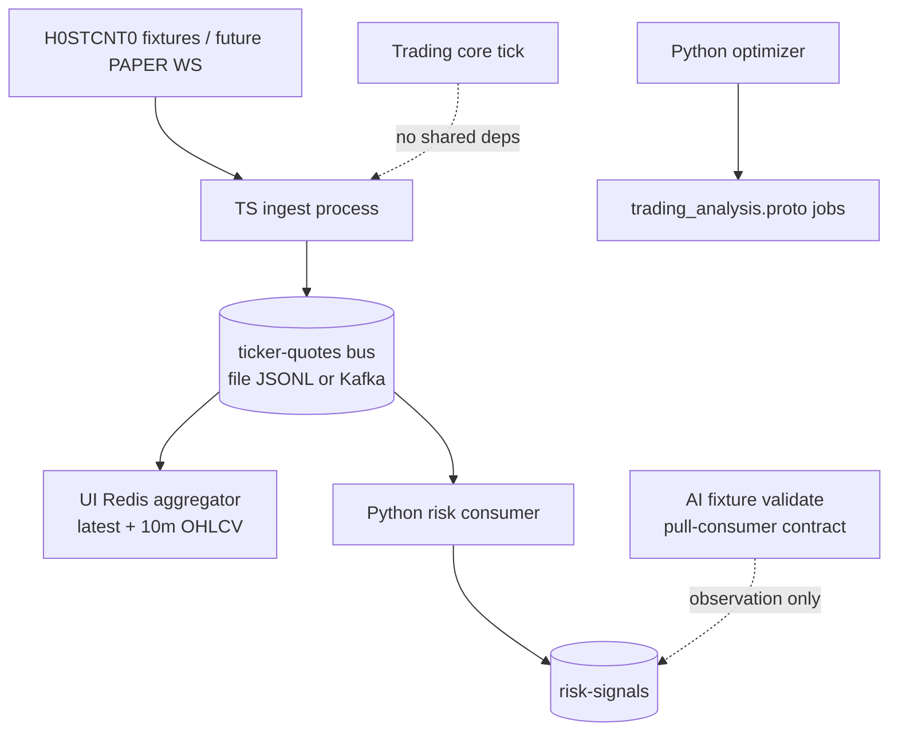
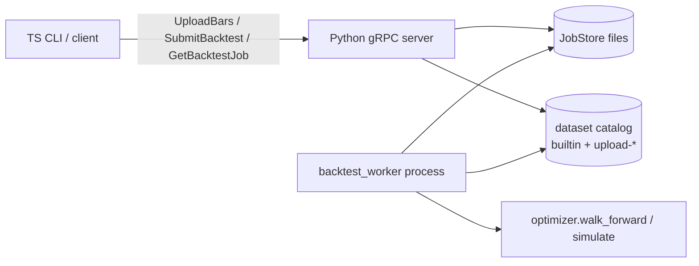
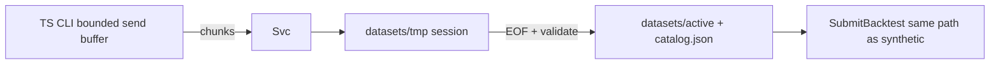
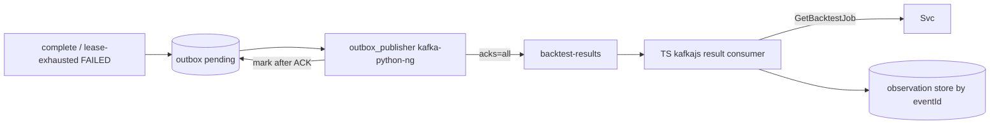
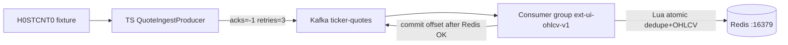

# Market streaming & research extensions

Default **OFF**. Runs as separate processes. Does **not** add Kafka/Redis/Python/gRPC to the Next.js trading core, and does **not** introduce new order-block conditions.

## Call relationships (existing core)

## Extension data plane

## Event model

| Field | Rule |
|-------|------|
| `partitionKey` | `KR:{symbol}` |
| `eventId` | `kind|market|symbol|exchangeTs|…` hash — TRADE dedupe key |
| `kind` | `TRADE` from H0STCNT0; `ORDERBOOK` from H0STASP0 (disabled until PAPER ASP0 verified) |
| `version` | Monotonic producer counter; ORDERBOOK last-write-wins coalesce |
| `exchangeTsMs` / `receivedTsMs` | Exchange vs ingest clocks |

## Limits & failure modes

| Cap | Value | Behavior |
|-----|-------|----------|
| Ingest queue | 2000 | Drop oldest; ORDERBOOK may merge latest per symbol |
| Publish batch | 50 / 25ms | Retries ×3 then count `publishErrors` |
| UI OHLCV window | 10 minutes | ZSET/minute map; one entry per minute start |
| TRADE volume | `CNTG_VOL` only | Never re-sum `ACML_VOL`; `eventId` dedupe |
| Job queue | 32 | `queue_cap_exceeded`; idempotent `idempotency_key` |
| UploadBars | streaming, small chunks | Prefer versioned `dataset_id` |

### Recovery limits

- **Kafka/file reprocess**: JSONL/Kafka offsets are re-readable → TRADE dedupe by `eventId` prevents double volume; ORDERBOOK coalesce is safe.
- **WebSocket origin loss**: frames never persisted before enqueue are **gone**. Incomplete minutes are marked when drops are observed; no silent fill from REST polling.

## AI contract

Reuses `docs/AI_CONTRACT.md` + `src/ai/trade-proposal-v1.ts` + `src/ai/pull-consumer.ts`.

- Accepted v1 modes always `orderEligible=false`
- Pull result always `autoOrderEnabled=false`
- `NO_TRADE` → `NON_ORDER_ACTION` (not converted to order candidate)
- `isOrder=true` → `IS_ORDER_FORBIDDEN`

## Python vs ATS backtest truth

| Layer | Role |
|-------|------|
| Python optimizer | Candidate search (MA, buyPct, stopLossPct) |
| `BacktestRunner` + `BacktestExecutionModel` | ATS execution truth |

Offline replay: export `Candle[]` and call `BacktestRunner.run({ candles, allocations })`. Gaps: session rails, OrderManager gates, daily vs synthetic bars — listed in optimizer output `gapsVsAts`. **No auto-apply to strategy-config.**

## Failure response

| Failure | Extension action | Trading core |
|---------|------------------|--------------|
| Kafka down | `publishErrors++`; queue may drop | Unaffected (separate process) |
| Redis slow | UI cache lag only | Order quotes still from core hub |
| Redis unavailable | Handler throws → **no** Kafka offset commit | Unaffected |
| Crash after Redis / before commit | Same `eventId` redelivered; Redis SET dedupe → volume unchanged | Unaffected |
| Queue saturation | `droppedTrades++`; minute marked `incomplete` | Unaffected |
| Python CPU saturate | Research delayed | Core tick independent |
| gRPC timeout | Job stays QUEUED/EXPIRED | No order impact |
| TRADE drop | Mark minute `incomplete` | N/A |
| PAPER ASP0 missing | Imbalance detector OFF (fixture vs live unverified) | N/A |

## TradingAnalysis gRPC (local)

### Recovery

| Failure | Rule |
|---------|------|
| Submit response lost | Retry same `idempotency_key` + same fingerprint → same `jobId` (no duplicate) |
| Server restart while `QUEUED` | Jobs remain on disk; worker claims after restart |
| Worker killed while `RUNNING` | Lease expiry → requeue (`attempt++`); after `max_attempts` → `FAILED` |
| Stale worker completes late | `lease_generation` / terminal-state guard → `StaleLeaseError` (no overwrite) |
| Queue full | `RESOURCE_EXHAUSTED` / `queue_cap_exceeded` |
| Unknown `dataset_id` | `NOT_FOUND` (catalog only; no filesystem paths) |
| Upload cancel / deadline / bad batch | Temp deleted immediately; never cataloged |
| Upload crash before register | Orphan `datasets/tmp/` force-purged on gRPC server boot (`purge_temps=force`); workers use `none` |
| Lost UploadBars response | Reupload same bars → same content-hash `datasetId` (`deduped`) |

### UploadBars streaming

| Cap | Env | Default |
|-----|-----|---------|
| Bars / chunk | `EXT_UPLOAD_MAX_BARS_PER_CHUNK` | 500 |
| Total bars / stream | `EXT_UPLOAD_MAX_TOTAL_BARS` | 50000 |
| Total wire bytes | `EXT_UPLOAD_MAX_TOTAL_BYTES` | 8 MiB |
| Concurrent uploads | `EXT_UPLOAD_MAX_CONCURRENT` | 2 |
| Client in-flight writes | `EXT_UPLOAD_CLIENT_SEND_BUFFER` | 3 |
| Orphan temp TTL (idle) | `EXT_UPLOAD_TEMP_TTL_MS` | 1h |

### Result notify (outbox)

| Rule | Behavior |
|------|----------|
| Outbox write | Same lock as terminal job commit |
| No outbox | Stale lease complete; retryable requeue |
| `eventId` | Stable per `(jobId, status)` — republish identical |
| Publisher | Python `kafka-python-ng` (grpc-up.sh); TS consumers stay kafkajs |
| Metrics | `pending_count`, `oldest_pending_age_ms` |
| Consumer | Apply observation then commit offset; gRPC fail → no commit |

## Real Kafka / Redis adapters (`EXTENSIONS_REAL_INFRA=1`)

- Brokers: `127.0.0.1:19092` (Redpanda via `extensions/docker-compose.yml`)
- Redis: `redis://127.0.0.1:16379`
- Dedupe TTL **24h**; OHLCV retention **10m**
- Latest price never rewinds on late `exchangeTsMs`
- Minute open = earliest exchangeTs; close = latest exchangeTs
