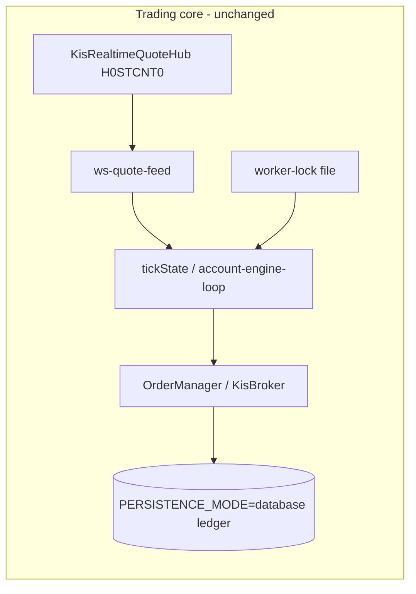
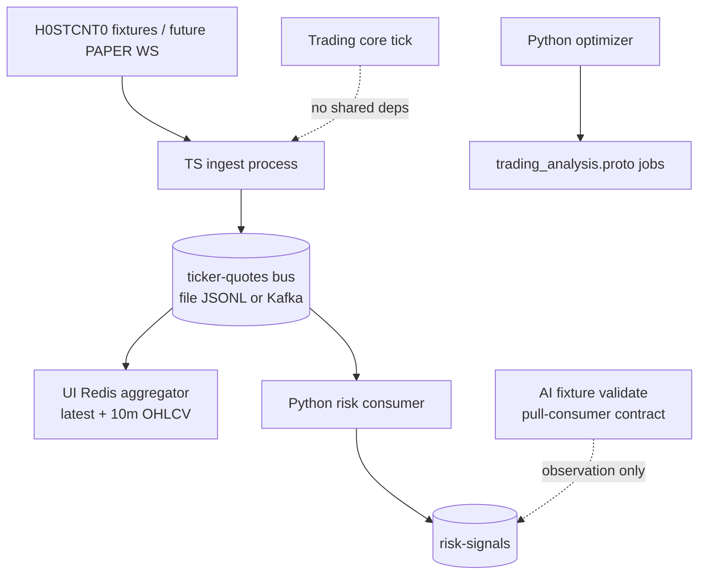

# Market streaming & research extensions

Default **OFF**. Runs as separate processes. Does **not** add Kafka/Redis/Python/gRPC to the Next.js trading core, and does **not** introduce new order-block conditions.

## Call relationships (existing core)

## Extension data plane

## Event model

| Field | Rule |
|-------|------|
| `partitionKey` | `KR:{symbol}` |
| `eventId` | `kind|market|symbol|exchangeTs|…` hash — TRADE dedupe key |
| `kind` | `TRADE` from H0STCNT0; `ORDERBOOK` from H0STASP0 (disabled until PAPER ASP0 verified) |
| `version` | Monotonic producer counter; ORDERBOOK last-write-wins coalesce |
| `exchangeTsMs` / `receivedTsMs` | Exchange vs ingest clocks |

## Limits & failure modes

| Cap | Value | Behavior |
|-----|-------|----------|
| Ingest queue | 2000 | Drop oldest; ORDERBOOK may merge latest per symbol |
| Publish batch | 50 / 25ms | Retries ×3 then count `publishErrors` |
| UI OHLCV window | 10 minutes | ZSET/minute map; one entry per minute start |
| TRADE volume | `CNTG_VOL` only | Never re-sum `ACML_VOL`; `eventId` dedupe |
| Job queue | 32 | `queue_cap_exceeded`; idempotent `idempotency_key` |
| UploadBars | streaming, small chunks | Prefer versioned `dataset_id` |

### Recovery limits

- **Kafka/file reprocess**: JSONL/Kafka offsets are re-readable → TRADE dedupe by `eventId` prevents double volume; ORDERBOOK coalesce is safe.
- **WebSocket origin loss**: frames never persisted before enqueue are **gone**. Incomplete minutes are marked when drops are observed; no silent fill from REST polling.

## AI contract

Reuses `docs/AI_CONTRACT.md` + `src/ai/trade-proposal-v1.ts` + `src/ai/pull-consumer.ts`.

- Accepted v1 modes always `orderEligible=false`
- Pull result always `autoOrderEnabled=false`
- `NO_TRADE` → `NON_ORDER_ACTION` (not converted to order candidate)
- `isOrder=true` → `IS_ORDER_FORBIDDEN`

## Python vs ATS backtest truth

| Layer | Role |
|-------|------|
| Python optimizer | Candidate search (MA, buyPct, stopLossPct) |
| `BacktestRunner` + `BacktestExecutionModel` | ATS execution truth |

Offline replay: export `Candle[]` and call `BacktestRunner.run({ candles, allocations })`. Gaps: session rails, OrderManager gates, daily vs synthetic bars — listed in optimizer output `gapsVsAts`. **No auto-apply to strategy-config.**

## Failure response

| Failure | Extension action | Trading core |
|---------|------------------|--------------|
| Kafka down | `publishErrors++`; queue may drop | Unaffected (separate process) |
| Redis slow | UI cache lag only | Order quotes still from core hub |
| Python CPU saturate | Research delayed | Core tick independent |
| gRPC timeout | Job stays QUEUED/EXPIRED | No order impact |
| TRADE drop | Mark minute `incomplete` | N/A |
| PAPER ASP0 missing | Imbalance detector OFF | N/A |
